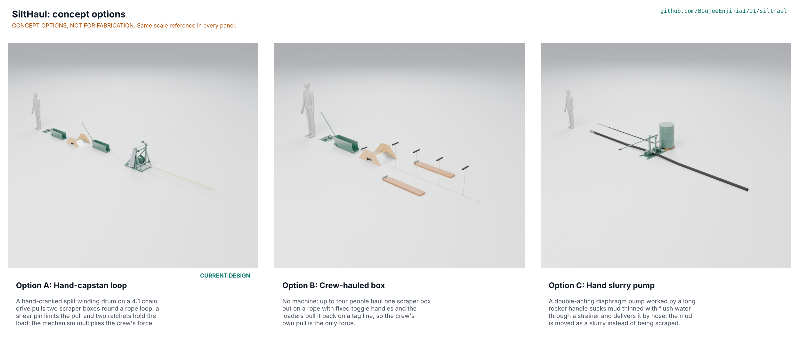

# SiltHaul concept options

Option B (crew-hauled box, 133 of 160) and option A (hand-capstan loop, 126 of 160) are within 10 % of each other (5.3 %), so both go to Amish without a pick; option C (hand slurry pump, 96) is well behind. The choice is awaiting Amish (SLH-DDR-005). Method: STANDARDS section 21. Option A is the existing design and was not changed; options B and C were added and modelled to the same detail (D3, `cad/src/model.py`).

## The options

### Option A: hand-capstan loop (existing design)

A hand-cranked split winding drum on a 4:1 chain drive pulls two scraper boxes round a rope loop: one full box goes out through the door while the empty one comes back. A 4 mm shear pin limits the rope to about 2.5 kN, two ratchet wheels hold the load when the cranks are let go, and a flat-pack frame is slung to a tree. Two people at the cranks need 63 N each; the crew of four moves 0.51 m3/h with rest (0.57 times a bucket crew; 0.497 if the loaders fill no faster than a shoveller). The independent review found the chain factor just under 5 at the 3 kN limit (4.93); fixes are proposed to Amish (SLH-STM-001 S5). 245 parts (161 fasteners), 153.9 kg, parts USD 1,055.60. Risks: a rope and chain system under tension (R6, R7, R11, R12), setup at the 20 min limit (R8), 22.2 kg heaviest lift. Needs from a co-design partner: a trial room and a crew.

### Option B: crew-hauled box

No machine. Up to four people haul one scraper box out on a rope with four fixed toggle grips, and the loaders pull it back on a tag line through the same tail sheave block and over the same doorway ramp. Foot boards with heel cleats are staked to the ground so the haulers push against stakes, not wet mud (the fix from SLH-STM-001 S19). A full box needs 756 N: 189 N each, hauling hand over hand at 0.4 m/s from the boards, 76 W each for 28 s of every 2.9 min cycle. Cycle 2.91 min, 0.62 m3/h with rest (0.69 times a bucket crew). 97 parts (55 fasteners), 80.5 kg. Risks: no overload limit and no brake, so a jammed box lets four people heave 1.6 kN on the rope (factor 10 on the rope); a hard, repeated whole-body pull on wet footing (ISO 11228-2 to check). Needs from a co-design partner: haulers of different builds to judge the pull.

### Option C: hand slurry pump

A double-acting diaphragm pump on a welded skid, worked by a 1.4 m rocker handle, sucks mud thinned with flush water through a strainer and delivers it by 75 mm hose through the door; a lance fed from a 200 L drum loosens and thins the mud. Flood mud (42 % solids by volume) is thinned to 15 %: 1.8 L of flush water for each litre of mud, 2.8 L of slurry out. With the 40 mm stroke that survived the STEM check (SLH-STM-001 S23) the pump gives 0.46 L/s of slurry, 0.44 m3/h of mud with rest (0.49 times a bucket crew, just below 0.5). Through 19 m of hose the handle needs 183 N each with two people (122 N with three). 62 parts (18 fasteners), 118.7 kg. Risks: sticks, stones and rubbish block the flap valves, 2.8 times the wet waste to dispose of (outside this project's scope, SLH-PRB-001), a flush water supply of about 18 L/min, and a diaphragm and manifold a village workshop cannot easily make. Needs from a co-design partner: real flood mud to test pumping.

Options Amish has already decided against are not re-proposed. Amish's earlier choices turned down the friction capstan (SLH-DDR-001 item 1), the 540 mm line spacing and the loose-tube frame (SLH-DDR-003), and replaced the single-box loop with two boxes (SLH-DDR-003, 2A). Options B and C are different working principles, and B differs from the single-box capstan loop because it has no drum, no chain drive and no machine at all.

## First-order numbers

Table 1. Options compared.

| Quantity | Option A | Option B | Option C |
| --- | --- | --- | --- |
| Estimated parts cost (USD) | 1,055.60 (BOM) | About 454 for the lines carried over from the BOM; foot boards and grips not priced | To assess; no priced list for the made pump |
| Mass (kg) | 153.9 | 80.5 | 118.7 |
| Output with rest (m3/h of mud) | 0.51 (ratio 0.57; 0.497 if loaders fill at a shoveller's rate) | 0.62 (ratio 0.69) | 0.44 (ratio 0.49) |
| Effort | 63 N each, two people, 48 W | 189 N each, four people, 76 W for 16 % of the cycle | 183 N each, two people, 39 W |
| Parts count (fasteners) | 245 (161) | 97 (55) | 62 (18) |
| STEM check | 6 within, 10 plausible, 1 fail with a fix proposed (S5) | 2 within, 1 plausible | 4 within, 2 plausible |

Costs are USD at the indicative prices in `bom/bom.csv`; option B counts the tail plate, sheaves, anchors, 45 m of rope (estimate), one box, tipping bar, ramp, one bridle set, four stakes, briefing card and paint. Throughput and effort are first-order estimates (SLH-CAL-001 for A, `docs/04-calcs/options_calc.py` for B and C).

## Scoring

Table 2. Weighted scoring (weights: High UR 3, Medium 2, Low 1; scores 1 to 5).

| Criterion | Source | Weight | A | B | C | Reason |
| --- | --- | --- | --- | --- | --- | --- |
| Nobody lifts or carries mud | UR-001 | 3 | 5 | 5 | 4 | A and B drag the box on a rope; C moves slurry by hose but the crew still drag hoses and carry flush water |
| Output against the bucket crew | UR-002 | 3 | 3 | 4 | 2 | With rest: A 0.51 m3/h (ratio 0.57), B 0.62 (0.69), C 0.44 (0.49, below the 0.5 target) |
| Effort per person at most 150 N | UR-003 | 3 | 5 | 2 | 3 | A 63 N each with two at the cranks; B 189 N each with four hauling; C 183 N each with two (122 N with three) |
| Fits through a 0.7 m doorway | UR-004 | 3 | 5 | 5 | 5 | All three pass in the models: ramp and boxes (A, B), hoses and strainer (C) |
| Reaches 15 m into the building | UR-005 | 2 | 4 | 4 | 3 | A 12 m of travel and B 17 m of rope; C needs 19 m of hose and its handle force rises with length |
| Safe near ropes, anchors and moving parts | UR-006 | 3 | 3 | 3 | 4 | A has a shear pin, ratchets and a guard but carries 3 kN rope and a chain drive; B has rope under up to 1.6 kN, no brake; C has no rope under tension, a swinging rocker and pinch points |
| Set up in 20 min by three people | UR-007 | 2 | 3 | 4 | 3 | A at the limit (about 20 min); B has no frame; C needs placing, priming and a water supply |
| Travels in a small car | UR-008 | 2 | 3 | 5 | 2 | A 407 L and 22.2 kg heaviest lift; B 80.5 kg in all; C 118.7 kg with a 900 x 500 mm skid |
| Affordable for a relief group | UR-009 | 2 | 3 | 5 | 3 | A USD 1,055.60; B about USD 454 carried over from the BOM, foot boards and grips not priced; C to assess |
| Made and repaired locally from stock | UR-010 | 3 | 4 | 5 | 2 | A is stock sections and bought bearings and chain; B is simpler; C needs an HDPE manifold block, flap valves and elastomer diaphragms |
| Survives mud and wet | UR-011 | 2 | 4 | 4 | 2 | A sealed bearings and paint; B the same; C valves and diaphragms meet grit |
| Keeps people out of the mud | UR-012 | 3 | 4 | 4 | 3 | Loaders stand in mud for A and B; C adds a lance, a strainer set by hand and slurry splash |
| Adds no wet waste to dispose of | UR-013 | 1 | 5 | 5 | 1 | C delivers 2.8 m3 of slurry for each m3 of mud |
| **Weighted total (of 160)** | | | **126** | **133** | **96** | A 79 %, B 83 %, C 60 % |

## Recommendation

No pick: B scores 133 and A 126, within 10 % of each other (5.3 %), so both go to Amish (SLH-DDR-005, Proposed, awaiting Amish). The trade is clear. B is half the mass, under half the cost and quicker per trip than A, but it asks each of four people for 189 N repeatedly on wet footing and has no overload limit or brake; A needs only 63 N each and has a shear pin, ratchets and a guard, but is a heavier, costlier machine with a rope and chain system under tension. Option C is not recommended: it misses 0.5 times the bucket crew, needs a water supply and an unbuildable diaphragm pump, and makes 2.8 times the waste.

Best idea to graft: from B to A, the staked foot boards give the crew at the dump a place to stand on wet mud, and B's quick manual haul suits rooms of 6 m or less where the capstan is not worth setting up; from A to B, a hand-held ratchet or a snubbing post on the tag line would give B a way to hold the box when the crew lets go.
